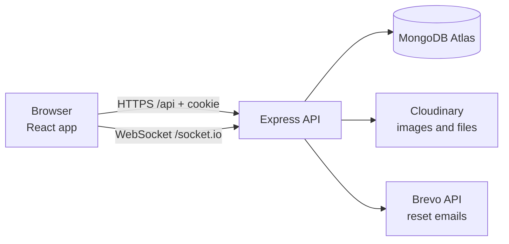
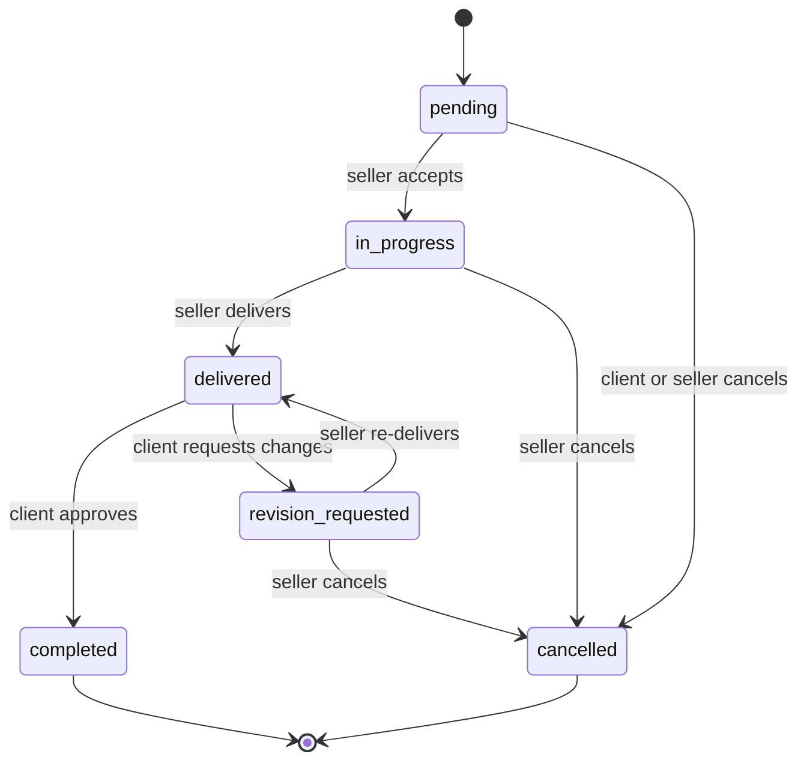

# GigCraft: Freelance Gig Marketplace

A full-stack marketplace where freelancers sell digital services and clients discover, order, message and review them. Built with React, Express and MongoDB.

**Live demo:** https://freelance-marketplace-react.onrender.com
(free hosting: the first load after a period of inactivity can take about a minute)

> **Payments are simulated.** Checkout holds the amount in a demo escrow and releases it when the client approves the delivery. No card details are collected and no real money moves, anywhere in the app.

## Contents

- [Features](#features)
- [Screenshots](#screenshots)
- [Tech stack](#tech-stack)
- [Architecture](#architecture)
- [Project structure](#project-structure)
- [Getting started](#getting-started)
- [Environment variables](#environment-variables)
- [Scripts](#scripts)
- [Database](#database)
- [How it works](#how-it-works)
- [API](#api)
- [Testing](#testing)
- [Deployment](#deployment)
- [Security](#security)
- [Troubleshooting](#troubleshooting)
- [Known limitations](#known-limitations)

## Features

**Clients**
- Browse and search gigs with server-side filters (category, price, delivery time, rating, seller tier, seller experience), sorting and pagination
- Save gigs, compare Basic / Standard / Premium packages, order with requirements and attachments
- Track orders, message the seller, request revisions, approve and release the (simulated) payment, cancel pending orders
- Review completed orders, see reviews you wrote and orders still waiting for one

**Freelancers**
- Public profile (photo, title, bio, skills, languages, work history) and portfolio with images and links
- Create, edit, publish, pause and delete gigs with Cloudinary images and three packages
- Accept or reject orders, deliver files, handle revision requests, reply to reviews or report them
- Dashboard with real stats, a 6-month earnings chart and payout history

**Platform**
- JWT authentication in an httpOnly cookie, two public roles (client, freelancer), session restore on refresh, "keep me signed in"
- Forgot / reset password by email, change password, self-service account deletion
- Order workflow enforced on the server (valid status changes only, and only by the right role)
- Ratings and review counts recalculated from stored reviews, never typed in
- Real-time messages and order updates with Socket.IO (polling fallback)
- Admin moderation: reported-review queue, hide and restore, user suspension, activity log
- Information pages: How it works, Help Center, Escrow explained, Community Guidelines, Terms, Privacy
- Code-split pages, error boundaries, gzip and asset caching

## Screenshots

_Add screenshots to `docs/screenshots/` and link them here (marketplace, gig detail, order page, dashboards, admin panel)._

## Tech stack

| Layer | Technology |
|---|---|
| Frontend | React, Vite 8, React Router, Tailwind CSS v4, React Hook Form, react-hot-toast, socket.io-client |
| UI | Designs from Google Stitch, Space Grotesk and Geist fonts, Material Symbols icons |
| Backend | Node.js 22, Express, Mongoose, express-validator, helmet, express-rate-limit, compression, Socket.IO |
| Database | MongoDB Atlas |
| Auth | JWT in an httpOnly cookie, bcrypt |
| Files | Cloudinary (multer, in-memory uploads) |
| Email | Brevo transactional email API |
| Tests | Vitest and Testing Library (client), `node:test` (server), API smoke test |
| CI / hosting | GitHub Actions, Render |

## Architecture



In production one Render service runs the API and also serves the built React app, so the browser sees a single origin and cookies stay first-party. In development, Vite serves the app on port 5173 and proxies `/api` and `/socket.io` to the API on port 5000.

All writes go through the REST API (validation, rate limits and permission checks live there). Socket.IO is push-only: the server notifies the right users, and the client reloads data through the normal API.

## Project structure

```
freelance-marketplace-react/
├── client/                      React app
│   ├── src/
│   │   ├── components/          ui, layout, gig, orders, messaging, reviews, dashboard, settings, auth
│   │   ├── pages/               public pages, orders, messages, dashboard/ (client, seller, admin)
│   │   ├── layouts/             Main, Auth, Dashboard
│   │   ├── contexts/            Auth, Favorites, Realtime
│   │   ├── hooks/ services/ utils/ routes/ realtime/ content/ test/
│   └── design-reference/        Original Stitch HTML exports (reference only)
├── server/
│   ├── src/
│   │   ├── config/              env, database, Cloudinary
│   │   ├── models/              12 Mongoose models
│   │   ├── controllers/ routes/ validators/ middleware/ services/ utils/
│   │   ├── realtime/            Socket.IO setup
│   │   └── seed/                demo seed, categories, cleanup
│   ├── docs/endpoints.js        Single source for the API docs and Postman collection
│   ├── scripts/                 generate-docs, smoke-test, make-admin, test-email
│   └── tests/                   Unit tests (node:test)
├── docs/                        Generated API.md and Postman collection
├── .github/workflows/ci.yml     Tests and build on every push
├── render.yaml                  Optional Render blueprint
├── package.json                 Root build/start scripts used by Render
└── README.md
```

**Models:** User, FreelancerProfile, PortfolioProject, Category, Gig, Order, Payment, Review, Favorite, Conversation, Message, ModerationLog.

## Getting started

### Prerequisites

- Node.js 20.19 or newer (developed on Node 22 and 24)
- A **MongoDB Atlas** cluster (free tier is fine). Orders use MongoDB transactions, which need a replica set, so a plain local `mongod` is not enough.
- A free **Cloudinary** account (only needed for image and file uploads)
- Optional: a free **Brevo** account for password-reset emails

### Install and run

```bash
# 1. Install
cd server && npm install
cd ../client && npm install

# 2. Configure the server
cd ../server
cp .env.example .env        # PowerShell: Copy-Item .env.example .env
# edit .env: MONGO_URI, JWT_SECRET and (optionally) Cloudinary and Brevo keys

# 3. Create the categories (the app needs them)
npm run seed:categories

# 4. Run, in two terminals
cd server && npm run dev    # API on http://localhost:5000
cd client && npm run dev    # App on http://localhost:5173
```

Generate a JWT secret:

```bash
node -e "console.log(require('crypto').randomBytes(48).toString('hex'))"
```

In Atlas, add your IP address under **Network Access**.

### Real accounts or demo data

- **Real accounts (recommended):** open the app and register a client and a freelancer. With no Brevo key, password-reset emails are printed in the server terminal instead of being sent.
- **Demo data (local, throwaway database only):** `npm run seed` wipes the database and creates demo accounts, gigs, orders and reviews. It refuses to run when `NODE_ENV=production` or when the database already contains real users (unless you pass `--force`).

Demo accounts created by the seed (password for all: `Password123!`):

| Role | Email |
|---|---|
| Client | client@gigcraft.test |
| Freelancers | elena@, marcus@, sarah@, david@, amina@, lucas@ `gigcraft.test` |
| Admin | admin@gigcraft.test |

These accounts exist only after you run the seed. The live site does not have them.

### Creating an admin

Admins can't be created through the website or the API. Register a normal account first, then:

```bash
cd server
npm run make-admin -- you@example.com
```

The script shows the database name and asks you to retype the email before it changes anything.

## Environment variables

`server/.env` (see `server/.env.example`):

| Variable | Purpose | Default |
|---|---|---|
| `MONGO_URI` | Atlas connection string (required) | none |
| `JWT_SECRET` | Token signing secret, 32+ characters in production (required) | none |
| `JWT_EXPIRES_IN`, `JWT_COOKIE_DAYS` | Session length | `7d`, `7` |
| `CLIENT_URL` | The site's public address. **One address**, no trailing slash, no comma. Used for CORS, WebSocket origin and email links | `http://localhost:5173` |
| `PORT` | API port | `5000` |
| `COOKIE_SAME_SITE` | `lax`, `strict` or `none` (`none` only for a frontend on another domain, needs HTTPS) | `lax` |
| `TRUST_PROXY` | Set to `1` behind a proxy such as Render | `0` |
| `AUTH_RATE_LIMIT`, `API_RATE_LIMIT` | Requests per 15 minutes | `20`, `300` |
| `SERVE_CLIENT` | `true` lets Express serve `client/dist` | `false` |
| `CLOUDINARY_CLOUD_NAME`, `_API_KEY`, `_API_SECRET` | Uploads | none |
| `BREVO_API_KEY`, `EMAIL_FROM`, `EMAIL_FROM_NAME` | Password-reset emails. Leave empty to print emails in the console | none |

`client/.env` (optional): `VITE_API_URL` (only when the API is on a different domain) and `VITE_CONTACT_EMAIL` (shown on the Help, Terms and Privacy pages).

Never commit `.env` files. Only `.env.example` files belong in Git.

## Scripts

**server/**

| Command | What it does |
|---|---|
| `npm run dev` / `npm start` | API with auto-reload / production |
| `npm run seed:categories` | Add the 8 categories (safe to repeat, never deletes) |
| `npm run seed` | Wipe the database and load demo data |
| `npm run db:clean:demo` | Remove only demo accounts and their data |
| `npm run db:clean:all` | Remove all users and data, then restore the categories |
| `npm run make-admin -- email` | Promote an existing account to admin |
| `npm run email:test -- email` | Send a test email through Brevo |
| `npm test` | Unit tests |
| `npm run smoke` | End-to-end API smoke test |
| `npm run docs` | Regenerate `docs/API.md` and the Postman collection |

**client/**

| Command | What it does |
|---|---|
| `npm run dev` | Dev server |
| `npm run build` | Production build into `dist/` |
| `npm test` / `npm run test:watch` | Unit and component tests |

## Database

- **One database** holds everything. Its name is the word between `.net/` and `?` in `MONGO_URI`. Collections are created automatically on first write.
- **Categories are required data**, not demo data: gigs need a category and the category strip comes from them. Use `npm run seed:categories` on an empty database.
- The cleanup scripts show the cluster and database name and make you type the database name before deleting anything.
- Keep a separate, throwaway database (for example `gigcraft_test`) for running `npm run seed` and `npm run smoke`, so real data is never touched.

## How it works

### Authentication

Login sets an httpOnly `token` cookie (secure in production). The app restores the session through `GET /api/auth/me` on every page load. Without "keep me signed in" the cookie ends when the browser closes. Passwords are hashed with bcrypt (cost 12) and must be 8 to 72 characters with a letter and a number. Changing a password signs out other devices.

Password reset: a one-time link valid for 15 minutes (only a hash of the token is stored), at most one email per account per minute. The response is always the same whether or not the account exists.

### Order workflow



One transition table on the server decides what is allowed and who may do it. The UI shows only the actions the server says are permitted.

### Payments (simulated)

The server calculates the price from the gig package and ignores any price or status sent by the client. Ordering creates a payment record in the `held` state. Approving the delivery releases it, and cancelling refunds it, in a MongoDB transaction together with the order change. Payment logic lives in `server/src/services/payment.service.js`, separate from orders, so a real gateway can replace it later.

### Reviews and ratings

Only the client of a completed order can review it, once. Gig and seller averages are recalculated from visible reviews whenever a review is created, hidden or restored. Sellers can reply publicly or report a review. Reviewers are shown as a first name and last initial.

### Real-time updates

Sockets authenticate with the same httpOnly cookie and JWT checks as the REST API, and each user joins a private room, so people only receive their own events. The client never sends data over the socket. If the connection drops, the message thread falls back to polling every 10 seconds and catches up on reconnect.

### Admin moderation

Admins get a separate dashboard: platform stats, the reported-review queue (hide or restore with a written reason, dismiss reports), user search with suspend and reactivate, and an activity log of every action. Suspending a seller pauses their published gigs, closes their live connections and blocks login. Admins can't suspend themselves or other admins.

### Account deletion

Users can delete their own account from Account Settings (password and a typed confirmation required, blocked while there are active orders). Their profile, portfolio, saved gigs, photo and gigs without orders are removed. The account is anonymised ("Deleted User") and the email is freed, while orders, messages and reviews stay for the other person's records and for accurate ratings.

### Uploads

Authenticated and rate limited. Images: JPG, PNG or WebP up to 5 MB. Deliverables and attachments: images, PDF, ZIP, JSON or text up to 25 MB. File contents are checked against their type, and files are stored in per-user folders. The server only accepts and deletes image references inside the caller's own folder.

## API

Base URL: `/api` (for example `http://localhost:5000/api`).

| Area | Prefix |
|---|---|
| Auth | `/auth` |
| Categories | `/categories` |
| Gigs and search | `/gigs` |
| Freelancer profiles | `/freelancers` |
| Account and profile | `/profile` |
| Portfolio | `/portfolio` |
| Uploads | `/uploads` |
| Orders | `/orders` |
| Payments | `/payments` |
| Reviews | `/reviews` |
| Favorites | `/favorites` |
| Conversations and messages | `/conversations` |
| Dashboards | `/dashboard` |
| Admin | `/admin` |
| Public stats | `/public` |
| Health | `/health` |

Success responses look like `{ "success": true, ... }`. Errors look like `{ "success": false, "message": "...", "details": [{ "field", "message" }] }`. List endpoints take `page` and `limit` and return `pagination`.

- Readable reference: [`docs/API.md`](docs/API.md)
- Postman: import [`docs/GigCraft.postman_collection.json`](docs/GigCraft.postman_collection.json), log in first, and ids fill in automatically.
- Both files are generated from `server/docs/endpoints.js` with `npm run docs`.

## Testing

| Layer | Command | What it checks |
|---|---|---|
| Server unit tests | `npm test` in `server/` | Order workflow rules, image-ownership check, request sanitizer (no database needed) |
| Client tests | `npm test` in `client/` | Formatters, password strength, CSV safety, pagination, route protection, login form, order actions, error boundary, stats panel, info pages, account deletion dialog |
| API smoke test | `npm run smoke` in `server/` | About 80 end-to-end checks: auth and roles, the full order lifecycle with escrow, reviews and ratings, messaging, favorites, gig management, dashboards, admin moderation, public stats, account deletion, and security cases such as price tampering and operator injection |
| CI | GitHub Actions | Runs both unit suites and a production build on every push |

Run the smoke test against a **throwaway database**, because it needs seeded data and creates and removes records:

```bash
# PowerShell: $env:MONGO_URI="...gigcraft_test..."  (use a throwaway database name)
npm run seed        # demo data
npm run dev         # terminal 1
npm run smoke       # terminal 2
```

If you hit "Too many attempts" (429) while testing, set `AUTH_RATE_LIMIT=200` in your local `.env`.

## Deployment

The app deploys as one service (for example on Render) where Express serves both the API and the built React app.

1. Push the repository to GitHub.
2. Create a **Web Service** on Render from the repository. Leave **Root Directory** empty.
   - Build command: `npm run build`
   - Start command: `npm start`
   - Health check path: `/api/health`
   - A `render.yaml` blueprint is included.
3. Set the environment variables:

   | Key | Value |
   |---|---|
   | `NODE_VERSION` | `22` |
   | `NODE_ENV` | `production` |
   | `SERVE_CLIENT` | `true` |
   | `TRUST_PROXY` | `1` |
   | `CLIENT_URL` | your Render URL, one address, no trailing slash |
   | `MONGO_URI`, `JWT_SECRET` | production values (`JWT_SECRET` 32+ characters) |
   | Cloudinary and Brevo keys | from their dashboards |

4. In Atlas, **Network Access** must allow the host. Render's free tier has no fixed IP, so use `0.0.0.0/0` together with a strong database password.
5. Run `npm run seed:categories` once against the production `MONGO_URI`, then register real accounts.

**Brevo setup:** verify your sender email in Brevo, create an API key, and turn off Brevo's IP blocking (Security, Authorised IPs), because Render's outbound IPs change. Render's free tier blocks SMTP ports, which is why the app uses Brevo's HTTPS API. A `@gmail.com` sender can land in the spam folder.

## Security

- Passwords hashed with bcrypt; httpOnly, SameSite cookies; tokens invalidated on password change
- Validation on every route with express-validator, field whitelisting on updates, a body sanitizer that strips MongoDB operator keys
- Ownership and participant checks on every private resource; other users get a 404 rather than confirmation that a resource exists
- Role-based authorization on routes and on the server; admin accounts can only be created by script
- Rate limits on auth, uploads, messaging and account deletion
- Helmet with a content security policy; CORS restricted to `CLIENT_URL`
- Upload type, size and file-signature checks; per-user storage folders
- Secrets only in server environment variables; production errors don't leak internals
- Real-time sockets use the same authentication as the API

## Troubleshooting

| Symptom | Likely cause and fix |
|---|---|
| Register or login shows "Cannot reach the server" (502) | The API isn't running. Check the server terminal for an error and open `/api/health` |
| `Invalid scheme, expected connection string to start with...` | `MONGO_URI` is malformed. It must be one line starting with `mongodb+srv://`, with no quotes or angle brackets |
| `CLIENT_URL must be a single site address...` | `CLIENT_URL` holds a comma, a space, a second line or a path. Use exactly one address |
| MongoDB connection timeout | Atlas Network Access doesn't include your IP |
| Reset email never arrives | Check the server logs for `[email]`. A 401 about an unrecognised IP means Brevo's IP blocking is on. Also check spam |
| `Refusing to seed: this database has real users` | Working as intended. Use a throwaway database for the seed |
| "Too many attempts" (429) | Auth rate limit reached. Wait 15 minutes, or raise `AUTH_RATE_LIMIT` locally |
| Icons show as plain words | The Material Symbols font link is missing from `client/index.html` |
| Gigs list is empty on a new database | Run `npm run seed:categories` and create a gig, or use the demo seed locally |

## Known limitations

- Payments are simulated. There is no real payment gateway and no formal dispute service.
- GitHub and Google sign-in buttons appear in the design but are not implemented.
- Only security emails are sent (password reset and password changed). There are no order or message emails.
- Categories are managed through the seed script, not an admin screen.
- Suspending a seller pauses their gigs but does not touch their existing orders.
- After account deletion, orders, messages and reviews are kept as "Deleted User", and files shared inside orders stay on Cloudinary.
- Cloudinary file links are unguessable but reachable by anyone who has the link.
- The free hosting tier sleeps when idle, so the first request can be slow.
- The legal pages are plain-language demo text, not legal advice.

## Author

Built by Rohit Kumar ([@rohit6522](https://github.com/rohit6522)) as a full-stack project.
